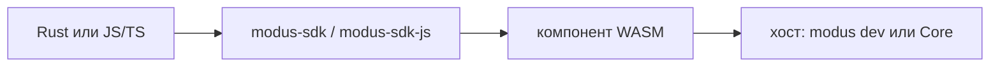

# Для кого это и чего ждать

Если это первый плагин — читайте эту главу и дальше по туториалу. Если нужен контракт ABI — [справочник](../introduction.md#справочник). Для виджета на TypeScript — сразу [глава 09](09-js-ts.md).

## Что такое плагин

**Modus** (в тексте ещё **Core**) — приложение стримера. Оно держит чат, секреты, сеть как песочницу и очередь алертов.

Плагин — не сайт и не бот со своим сокетом. Это модуль внутри приложения. Хост выдаёт чат. Сеть — только если вы её попросили в манифесте, как розетку: сам плагин в интернет не ходит.

Гость живёт в WASM: без диска, без своих сокетов, без доступа к файлам стримера.

Хост пускает только то, что разрешил манифест. Запись в манифесте без вызова в коде — нормально. Вызов без записи — пакет не соберётся и не загрузится.

## Три слова, которые стоит уметь повторить

1. **Шина** — канонические события (`message`, `donation` и остальные). Их кладёт коннектор площадки или учебная фикстура. Consumer только слушает.
2. **`wait`** — единственный длинный цикл в `run`. Плагин зовёт `wait` и спит. Хост будит, когда есть чат, таймер, стоп или команда. Самому «слушать» в другом месте нельзя: один `run`, один ящик.
3. **Почтовый ящик** — так удобно думать про `wait`: письмо кладёт хост, плагин его забирает и снова ждёт.

Точнее про цикл и канон — в справочнике, когда дойдёте.

## Что получится после туториала

Часть 1 (без коннектора, ориентир 2–4 часа):

1. поставить тулчейн;
2. сгенерировать consumer;
3. увидеть в терминале `fixture hello`;
4. понять, что сеть даёт хост, а не wasm;
5. упаковать `.mplug` и знать, куда его класть в приложении;
6. отличить consumer от коннектора и не начать с Twitch.

Вы напишете **слушателя шины**, не клон Twitch. Площадку, OAuth, оверлей OBS и командира часть 1 не обещает — для них есть другие роли `new` после туториала.

Другие роли (panel, reader, player, bridge, widget, …) в ABI **есть**; этот туториал их не проводит. Карта — [глава про роли](02-roles.md) и [справочник](../ref/01-roles.md).

## Что понадобится

- Windows — как у продукта.
- Для части 1 (Rust consumer): Rust stable и цель `wasm32-unknown-unknown` (поставим в следующей главе).
- Для JS/TS виджета: Node ≥20 + [modus-sdk-js](https://github.com/CaptainGnome/modus-sdk-js); бинарь `modus` всё равно из [modus-sdk](https://github.com/CaptainGnome/modus-sdk) — [глава 09](09-js-ts.md).
- Публичные clone: [modus-sdk](https://github.com/CaptainGnome/modus-sdk) (CLI), рядом удобны [modus-docs](https://github.com/CaptainGnome/modus-docs), [modus-examples](https://github.com/CaptainGnome/modus-examples), при JS — `modus-sdk-js`. SDK пока не на crates.io.
- PowerShell, чтобы копировать команды.

**Установленный** Modus — только в конце, когда будете ставить `.mplug`. Отладка — `modus dev` в терминале, не окно Core.

Языки гостя: **Rust** (все роли) и **JS/TS** (widget / alerter). Хост языку не видит.

## Два текста

| Путь                                  | Для кого                 | Как читать                                                 |
| ------------------------------------- | ------------------------ | ---------------------------------------------------------- |
| [Туториал](../introduction.md#туториал)     | первый плагин            | сверху вниз, каждая глава даёт строку в терминале или файл |
| [Справочник](../introduction.md#справочник) | контракт, лимиты, ошибки | с оглавления                                               |

Команды, идентификаторы и строки ошибок хоста — как в ABI, без «улучшения» перевода.

Следующая глава — [поставить инструменты](01-tools.md).